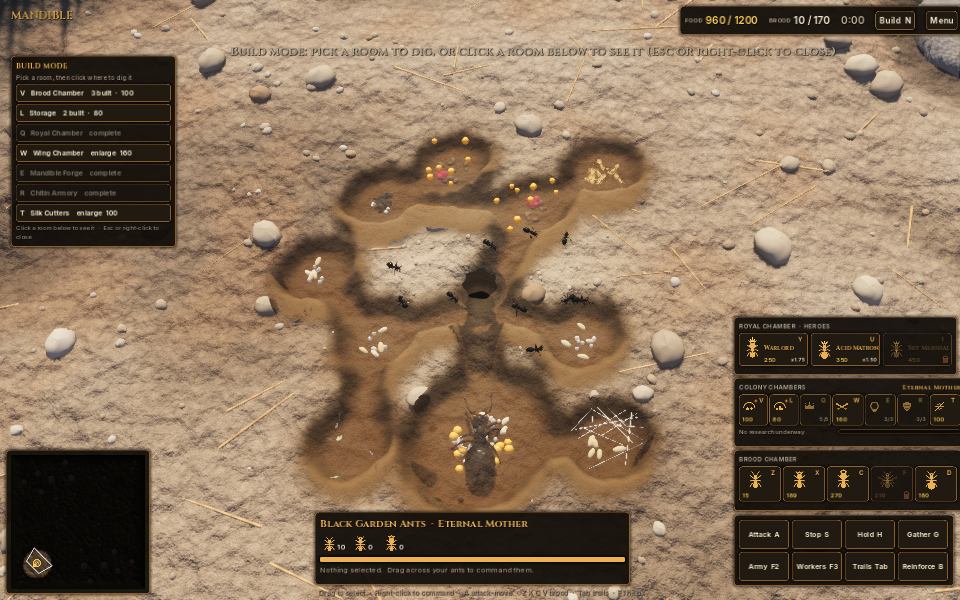
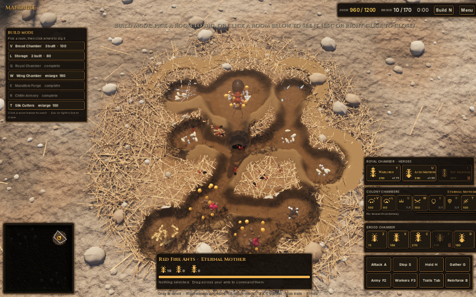

# Connected colony renderer

Implemented against `main` revision `158911b16ba1359b67d0500881204162451f3acb` on 2026-11-01, on branch `codex/continuous-colony-tunnels`.

## Problem and resulting behavior

The previous renderer set `room.Tunnel.Scale` and subsequently assigned an unscaled `Basis`, replacing the scale and reducing long galleries to unit-length stubs. Independent inward-facing room bowls also left walls and mismatched floors at intersections. The resulting scene looked like separate open bowls, with a large crater and dense gravel hiding the connections.

`NestGeometry` unions gallery capsules and elliptical chambers into a signed-distance field before triangulation. One continuous excavation mesh per visible colony replaces all room shells, floor discs and individual tubes. Doorways have no internal walls or overlapping floors. Room sizes and galleries come from the existing simulation graph; no new connections or gameplay routes are invented.

The mesh, soil transparency mask and picking use the same nest-local layout. The CPU and shader implementations of the distance function must remain equivalent. The shader projects the camera ray onto the presentation floor, accounting for the actual terrain height, so the roof stays aligned during rotation. Meshes rebuild only when quantized digging progress, chamber layout, upgrades or the graphics tier change. Replaced meshes are disposed.

All displayed underground ants and room contents use the same horizontal floor 2.4 units beneath the entrance datum. Simulation room depths, navigation, commands, economy and lockstep logic are unchanged. Surface mound profiles are lowered in `WorldBuilder`, with less and smaller excavated gravel. This changes terrain heights and decoration, so both multiplayer clients should use the same version, as usual.

The real entrance is cut out of the terrain shader and backed by a dark shaft. The soil roof retains 36% opacity over the colony, with texture and soft cavity shadows. The roof does not write depth; build-mode depth-of-field blur is disabled so High/Ultra do not blur the entire transparent scene. Underground selection projects onto the displayed floor. Room inspection takes priority over ants when clicking inside a room in build mode, and hidden underground ants cannot be selected from the closed surface view.

Labels are small and appear for the selected chamber or active excavation, rather than overlapping across every room.

## Actual game captures

Godot 4.7.2 .NET, Forward+ Vulkan, High quality, Linux software graphics. These are engine screenshots, not concept artwork.





## Reproduce

```sh
dotnet build
godot --headless --path . -- --nesttest=headless
godot --path . -- --gfx=High --nesttest=captures/colony-black
godot --path . -- --gfx=High --nesttest=captures/colony-red,red
godot --headless --path . -- --synctest=60
godot --headless --path . -- --simtest=90,Normal,Normal
```

The render fixture initializes the simulation once before pausing (the ant renderer needs a populated spatial hash), develops the real colony, tests all room centres at three camera rotations, and captures the overview, rotation, close selection, a live switch to Low, and the closed surface.

## Validation and limits

- C# build: passed, no errors; three pre-existing compiler warnings in Main, Lockstep and Capture.
- Geometry regression: passed for continuous branch routes, undug soil, progress expansion, upgrades, static geometry caching, valid mesh data and empty/full shader capacity.
- Actual developed-colony routes and rotation-aware room picking: passed in the render fixture.
- 90-second AI simulation smoke test: completed, peak 132 ants.
- 60-second checksum exercise completed on Linux x86_64: Colony `4B93361E`, Lane War `0F5537FC`. This is a local exercise, not a cross-platform or two-client synchronization claim.
- Visual review: connected passages, open entrance, reduced label clutter and retained soil coverage inspected in the actual engine. High and Low views are covered by the fixture.
- Godot emits CanvasItem/ObjectDB/font-resource cleanup warnings at test shutdown. No shader-compilation errors were reported. Shutdown resource ownership remains separate follow-up work.
- Software graphics timings are not a desktop/mobile performance benchmark. Windows, macOS and physical-device validation remains to be done.

The change is prepared for review and has not been merged into main or included in a released executable.
